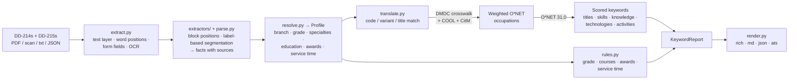

# v2c-translator: Veteran-to-Civilian Occupation Translator

Turn military service records into the language civilian employers search for.

`v2c-translator` parses military personnel documents and translates military experience
into civilian workforce equivalents: occupations, job titles, skills, knowledge areas,
technologies, work activities and ATS-ready keywords. It is grounded in the official
DoD/DMDC military occupational crosswalk and the U.S. Department of Labor's O*NET
database.

The first component, **`dd214kw`**, reads a veteran's **DD Form 214s**, plus any
**DD Form 215** corrections and their **VMET** (DD Form 2586), and produces one ranked set
of civilian keywords. Every keyword can be traced back to the document and block, and the
data source, it came from.

> **Status: v0.1 (alpha).** It works end to end on synthetic DD-214s for the Army, Navy,
> Air Force and Marine Corps, in both the 2000 and 2022 form layouts. It merges several
> DD-214s for separate periods, DD-215 corrections given as JSON, and a VMET into one
> report. It has not yet been validated against a corpus of real DD-214s or VMETs. See
> [Known limitations](#known-limitations) and [Roadmap](#roadmap).

---

## Contents

- [What it does](#what-it-does)
- [Quick start](#quick-start)
- [CLI reference](#cli-reference)
- [Input formats](#input-formats)
- [Output formats](#output-formats)
- [Web app](#web-app)
- [How it works](#how-it-works)
- [Data sources and licensing](#data-sources-and-licensing)
- [Privacy and responsible use](#privacy-and-responsible-use)
- [Sharing your DD-214 layout safely](#sharing-your-dd-214-layout-safely)
- [Project structure](#project-structure)
- [Development](#development)
- [Customizing the translation](#customizing-the-translation)
- [Known limitations](#known-limitations)
- [Roadmap](#roadmap)
- [Attribution](#attribution)

---

## What it does

Given one person's DD-214s, any DD-215s and their VMET, `dd214kw`:

1. **Extracts** text from a PDF, a scanned image (with OCR), plain text, or pre-extracted JSON.
2. **Parses** the occupation-relevant blocks of each DD-214, whichever of the two layouts it is:
   - branch and component
   - rank and pay grade
   - every specialty, with time in each
   - decorations and badges
   - military education
   - net, prior, foreign and sea service time
3. **Reads** a VMET's occupations, each with the O*NET occupations the VMET lists for it,
   and its courses, with ACE IDs and descriptions.
4. **Merges** every document into one profile. Service time from separate periods adds
   up, a DD-215 replaces the values for the period it corrects, and a specialty, course
   or award that appears on several documents counts once.
5. **Matches** each specialty (Army MOS, Air/Space Force AFSC, Navy rating, Marine Corps
   MOS, Coast Guard rating) to the DMDC crosswalk. It handles skill-level suffixes, retired
   codes and written-out titles.
6. **Maps** each code to weighted civilian occupations (O*NET-SOC), including the ones
   the VMET lists for it. Military-only occupations are replaced with curated civilian
   equivalents.
7. **Scores** keywords in nine categories and merges them with evidence-based rules for
   leadership scope, training, recognition and experience.
8. **Outputs** a terminal report, Markdown, JSON, or a comma-separated ATS keyword string.

Excerpt for a synthetic Navy ET1 with 10 years of service
(full output: [`docs/examples/navy_2022.md`](docs/examples/navy_2022.md)):

| DD-214 entry | Matched | Top civilian occupations |
|---|---|---|
| ELECTRONICS TECHNICIAN (ET) 8 YRS 6 MOS | `N/ET` Electronics Technician | Electrical & Electronics Repairers, Commercial & Industrial Equipment; Telecommunications Engineering Specialists; Electromechanical Equipment Assemblers |
| INFORMATION SYSTEMS TECHNICIAN (IT) 2 YRS 0 MOS | `N/IT` Information Systems Technician | Network & Computer Systems Administrators; Computer & Office Machine Repairers; Electrical & Electronic Engineering Technicians |

- **Skills:** Repairing, Troubleshooting, Equipment Maintenance, Network Administration,
  Quality Control Analysis, Operations Monitoring, …
- **Technologies:** Linux, UNIX, Python, SQL, Microsoft PowerShell, Windows Server, …
- **Leadership:** First-Line Supervision, Team Leadership, On-the-Job Training,
  Performance Counseling, …
- **Experience:** U.S. Navy Veteran, 10+ Years Professional Experience, Maritime Operations

---

## Quick start

**Requirements:** Python ≥ 3.12, [uv](https://docs.astral.sh/uv/), and about 20 MB of
download for the public data.

```bash
git clone https://github.com/reh3376/v2c-translator.git
cd v2c-translator
uv sync

# One-time: download O*NET + DMDC crosswalk data and build the local index (~5 s)
uv run dd214kw build-index --download

# Translate a DD-214
uv run dd214kw translate path/to/dd214.pdf

# Or every record for one person: DD-214s for each period, plus DD-215 corrections
uv run dd214kw translate dd214_2014.pdf dd214_2022.pdf dd215.json
```

Try it on the bundled synthetic samples:

```bash
uv run dd214kw translate tests/fixtures/army_2000.txt --explain
uv run dd214kw translate tests/fixtures/navy_2022.txt -f md -o navy.md
uv run dd214kw translate tests/fixtures/airforce.json -f json
uv run dd214kw translate tests/fixtures/marines.json -f ats
uv run dd214kw translate tests/fixtures/army_2000.txt tests/fixtures/army_2000_dd215.json -f md
uv run dd214kw translate tests/fixtures/army_2000.txt tests/fixtures/army_vmet.txt
```

Optional OCR support for scanned DD-214s:

```bash
uv sync --extra ocr
# also install the system binaries: tesseract and poppler
#   macOS:  brew install tesseract poppler
#   Debian: apt install tesseract-ocr poppler-utils
uv run dd214kw translate scanned_dd214.pdf --ocr
```

---

## CLI reference

```
dd214kw [--index PATH] {build-index, translate, lookup, inspect-layout} ...
```

The global option `--index PATH` sets the location of the SQLite index. It defaults to
`$DD214KW_INDEX` or `~/.local/share/dd214kw/index.sqlite`.

### `build-index`

Downloads the source data (if asked) and builds the SQLite index.

| Option | Default | Description |
|---|---|---|
| `--download` | off | Fetch any missing source files from onetcenter.org |
| `--raw-dir DIR` | `data/raw` | Where source files are stored or looked for |

### `translate FILE...`

Translates one person's documents into one report. Pass every DD-214, DD-215 and VMET for
that person, in any order:

- DD-214s for separate periods add up. Net active service is summed across the periods.
- A DD-215 corrects the DD-214 whose separation date it names. See
  [DD-215 JSON schema](#dd-215-json-schema).
- A specialty on both a DD-214 and a VMET is one match, with the longer time in it.

The content of each file decides its document type. If a file can't be read, the command
exits with code 2 and the error names that file.

```bash
uv run dd214kw translate tests/fixtures/army_2000.txt tests/fixtures/army_2000_dd215.json -f md
uv run dd214kw translate tests/fixtures/army_2000.txt tests/fixtures/army_vmet.txt
```

| Option | Default | Description |
|---|---|---|
| `-f, --format {rich,md,json,ats,json+md}` | `rich` | Output format (see [Output formats](#output-formats)) |
| `-o, --output PATH` | stdout | Write to a file instead (`rich` becomes Markdown) |
| `--top N` | `12` | Keywords per category |
| `--limit N` | `40` | Number of terms in the ATS string |
| `--explain` | off | Show each keyword's score and sources (`rich` format) |
| `--ocr` | off | OCR a PDF that has no text layer (needs the `ocr` extra) |
| `--max-pages N` | no limit | Refuse a document longer than N pages, counted before any page is read |
| `--json-input` | auto for `.json` | Read every FILE as text, with no OCR |
| `--branch NAME` | detected | Override branch: `Army`, `Navy`, `Air Force`, `Space Force`, `Marine Corps`, `Coast Guard` |

### `lookup CODE`

Inspect how a single military code is crosswalked. This is useful for debugging and for
reviewing mappings.

```console
$ uv run dd214kw lookup 68W --branch Army
A 68W [E] Combat Medic Specialist status=A
  -> 29-2043.00 Paramedics  w=1.0  (dmdc)
  -> 31-1121.00 Home Health Aides  w=0.563  (cool)
  -> 29-1214.00 Emergency Medicine Physicians  w=0.38  (citm)
  -> 29-1141.03 Critical Care Nurses  w=0.369  (citm)
  ...
```

### `inspect-layout FILE`

Prints where things sit on a DD-214 page, with no text from it. See
[Sharing your DD-214 layout safely](#sharing-your-dd-214-layout-safely).

| Option | Default | Description |
|---|---|---|
| `--ocr` | off | OCR a PDF that has no text layer (needs the `ocr` extra) |
| `-o, --output PATH` | stdout | Write the text to a file instead |
| `--png PATH` | none | Also draw the geometry as a picture |

---

## Input formats

| Input | How it's read |
|---|---|
| `.pdf` with a text layer | `pypdf` text extraction plus any fillable-form field values, and each word's position from `pdfminer.six`. A DD-214 is read by [block position](#reading-a-pdf-by-block-position). |
| `.pdf` scan | `--ocr`: `pdf2image` + Tesseract, at the scan's own resolution up to 300 dpi |
| `.png` `.jpg` `.tif` … | Tesseract OCR (needs the `ocr` extra) |
| `.txt` | Read as-is |
| `.json` | Pre-extracted DD-214 or DD-215 fields, for use with an upstream OCR or LLM extraction step |
| VMET (DD Form 2586), `.pdf` or `.txt` | The labels of the 2010 edition, taken from publicly posted samples. It is not yet validated on a real VMET. From the header line that holds the name, only the pay grade is read. |

A DD-215 is read only as JSON. There is no reader for DD-215 text or PDF yet.

### DD-214 JSON schema

Every field is optional. Values can be strings (entries separated by `//`, `;` or
newlines) or lists. Dates are `YYYY-MM-DD` or `YYYYMMDD`.

```json
{
  "branch": "AIR FORCE/REGULAR",
  "grade": "TSGT",
  "pay_grade": "E-6",
  "specialty": ["3D172 CYBER TRANSPORT SYSTEMS CRAFTSMAN 7 YRS 2 MOS",
                "2T151 VEHICLE OPERATOR JOURNEYMAN 2 YRS 0 MOS"],
  "decorations": ["AIR FORCE COMMENDATION MEDAL W/ 1 OAK LEAF CLUSTER"],
  "education": ["AIRMAN LEADERSHIP SCHOOL, 6 WKS, 2016", "NCO ACADEMY, 6 WKS, 2020"],
  "net_active": "0009 03 00",
  "prior_active": {"years": 0, "months": 0, "days": 0},
  "foreign_service": "0002 00 00",
  "sea_service": "0000 00 00",
  "separation_date": "2023-09-30"
}
```

`separation_date` is block 12b (2000 form) or 13b (2022 form). It names the service
period. DD-214s with different separation dates add up, and a DD-215 corrects the DD-214
with the same date. Without it, a DD-215's service time is added to the DD-214's instead
of replacing it. An optional `form` key must be `DD-214`.

### DD-215 JSON schema

A DD-215 corrects one DD-214. `form` must be `DD-215`, and `corrects_separation_date` is
required.

```json
{
  "form": "DD-215",
  "corrects_separation_date": "2022-06-01",
  "issued": "2023-03-15",
  "net_active": "0009 01 00",
  "decorations": ["ARMY COMMENDATION MEDAL (3RD AWARD)"],
  "education": ["MASTER FITNESS TRAINER COURSE, 2 WEEKS, 2021"]
}
```

| Key | Meaning |
|---|---|
| `form` | `DD-215`. This key selects the DD-215 reader. |
| `corrects_separation_date` | Required. The separation date of the DD-214 that this DD-215 corrects. |
| `issued` | Optional. When two DD-215s correct the same period, the later one wins. |
| `net_active`, `prior_active`, `foreign_service`, `sea_service` | The corrected value. It replaces the DD-214's value for that period. |
| `specialty`, `decorations`, `education` | Entries to add. An award listed again keeps its highest count. |
| `branch`, `component`, `grade`, `pay_grade` | Not applied. The report adds one note that names them. |

---

## Output formats

### `rich` (default)

A terminal report with a service summary, a specialty → occupation match table, one
section per keyword category, the ATS string, and any warnings. Add `--explain` to see
each keyword's normalized score and the sources behind it.

### `md`

The same content as Markdown, ready for a resume worksheet or case file. Examples for all
four synthetic service members are in [`docs/examples/`](docs/examples/).

### `ats`

A flat, de-duplicated, comma-separated list of short terms. It takes terms round-robin
across categories so no single category dominates. Long sentences and parenthetical
expansions are left out.

```text
Career/Technical Education Teachers, Negotiation, Microsoft Office software, Advanced Leadership,
Public Safety and Security, Advanced Leader Course (2019), U.S. Army Veteran, Recognized for
Performance Excellence, Instructing, Microsoft Outlook, Operations Management, ...
```

### `json`

Full structured output for downstream systems (resume builders, job matching, analytics):

```jsonc
{
  "profile":  { "context": { "branch": "Navy", "pay_grade": "E6", ... }, "occupations": [...], ... },
  "documents": [{ "doc_type": "dd214", "doc_id": "…", "layout": "2022", "notes": [] }],
  "matches": [{
      "specialty": { "title": "ELECTRONICS TECHNICIAN (ET) 8 YRS 6 MOS", "months": 102, ... },
      "svc": "N", "code": "ET", "title": "Electronics Technician", "method": "code",
      "occupations": [
        { "onet": "49-2094.00", "weight": 1.0, "sources": ["dmdc"],
          "title": "Electrical and Electronics Repairers, Commercial and Industrial Equipment" },
        ...
      ]
  }],
  "keywords": {
    "skills": [
      { "term": "Troubleshooting", "category": "skills", "score": 0.934,
        "sources": ["Electrical and Electronics Repairers, ...",
                    "course: AN/SPY-1 Radar System Maintenance C School"] },
      ...
    ],
    "job_titles": [...], "knowledge": [...], "technologies": [...], "work_activities": [...],
    "leadership": [...], "training": [...], "recognition": [...], "experience": [...]
  },
  "ats_keywords": ["Electronic Technician", "Repairing", ...],
  "warnings": [],
  "attribution": "Occupation data: O*NET 31.0 Database and DMDC Military Occupational Crosswalk, ..."
}
```

### `json+md`

Both of the above in one envelope, from one reading of the documents:

```jsonc
{
  "report":   { /* exactly what `-f json` prints */ },
  "markdown": "# Civilian Workforce Keywords\n\n- Branch: Navy\n…"
}
```

This exists for a caller that wants both, such as the web app's `/api/translate`: a
scanned page is then OCR'd once instead of once per format, which halves the memory and
the time one upload costs. See [Sizing](docs/deploy.md#sizing).

**Keyword categories**

| Key | Source | Contents |
|---|---|---|
| `job_titles` | O*NET | Occupation titles plus common reported titles ("Network Administrator", "Truck Driver") |
| `skills` | O*NET + course rules | Transferable skills ranked by distinctiveness |
| `knowledge` | O*NET | Knowledge areas ranked by distinctiveness |
| `technologies` | O*NET | Software and tools, boosted when hot or in demand, discounted when ubiquitous |
| `work_activities` | O*NET | Detailed work activities from core tasks (resume-bullet material) |
| `leadership` | Pay grade + course rules | Leadership scope appropriate to the grade |
| `training` | Military education block | Courses with completion year |
| `recognition` | Decorations block | Performance recognition, deployments, qualifications |
| `experience` | Record of service | Veteran status, years of experience, international or maritime service |

---

## Web app

[`web/`](web/) is a web page for counselors and transitioning service members. A person
drops in their DD-214s, DD-215s and VMET and gets the same report as `dd214kw translate`,
with Markdown and JSON downloads.

It runs in one of two modes, and `local` is the default, so nothing below changes if you
have been running it already. **Local** is the app on your own computer: it listens on
127.0.0.1, asks no bot check, and the page says the documents never leave the machine,
because they don't. **Hosted** is the same app behind someone else's web server, open to
anyone, which it says so on the page and which brings a Cloudflare Turnstile check, a
per-visitor limit and a queue with it. One container image runs either way; the mode is
one environment variable, read at boot. [`docs/deploy.md`](docs/deploy.md) is the hosted
half, including what it takes to publish it at a path on an existing site.

Running it locally needs Node 22, pnpm 10 and the index from
[Quick start](#quick-start):

```bash
uv run dd214kw build-index --download   # once
cd web
pnpm install
pnpm dev                                 # then open http://localhost:3009
```

For a production server on your own machine, run `pnpm build && pnpm start`. The CLI
reads `DD214KW_INDEX` as usual. `DD214KW_REPO_ROOT` (default `..`) and `DD214KW_UV`
(default `uv`) tell the app where the repository and `uv` are; the container image sets
`DD214KW_BIN` instead and needs neither.

To run the hosted app on your own machine, with Docker, see
[`web/TESTING.md`](web/TESTING.md). To deploy it, see
[`docs/deploy.md`](docs/deploy.md).

**Privacy, in local mode.** Documents never leave the computer:

- The server listens on 127.0.0.1 only.
- `/api/translate` writes the uploaded files to a new temp directory with mode 0700, runs
  the CLI on them with `execFile`, and deletes the directory in a `finally` block. The
  page shows the file name and the CLI's message, never the file's contents.
- Nothing about a document reaches a log. A failure logs a request id and the kind of
  failure, because the CLI's error output begins with the file name and a file name is
  already a disclosure. `web/src/server/logging.test.ts` holds it to that.
- The page bundles its fonts and loads nothing from other hosts. Its
  Content-Security-Policy blocks connections to any other origin.
- Next.js can send anonymous usage telemetry about the build, never documents. Turn it off
  with `pnpm exec next telemetry disable`.

**Privacy, in hosted mode.** Documents are sent, and the page says so rather than
claiming otherwise. Uploads are read from a tmpfs and deleted when the report is ready,
the root filesystem is read-only, nothing is stored, and the only request that leaves the
server is the Turnstile check, which carries a token and no document. The whole model,
clause by clause, is in [`docs/deploy.md`](docs/deploy.md#the-privacy-model).

**The wording is one file.** Every sentence that differs between the two modes lives in
[`web/src/content/copy.ts`](web/src/content/copy.ts), keyed by mode, and
`copy.test.ts` holds each mode to what it can honestly claim: the hosted copy may not say
the documents stay put, and the local copy may not talk about uploading.

**Engine seam.** The page calls `engine.translate(files, turnstileToken)`, exported by
[`web/src/engine/index.ts`](web/src/engine/index.ts). The one engine today, `localEngine`,
posts the files to `/api/translate`. A Pyodide engine that runs `dd214kw` in the browser
would replace that one export. Each engine parses its output into a `Report`, the zod
schema in [`web/src/engine/report.ts`](web/src/engine/report.ts) for
`KeywordReport.to_dict()`, so the page never sees raw JSON.

**Markdown.** The route runs the CLI once, with `-f json+md`, which prints both formats
from one reading of the documents as `{"report": …, "markdown": …}`. `render.py` stays the
only Markdown renderer.

**Pictures.** One per branch, under [`web/public/branches/`](web/public/branches) and listed in
[`web/src/content/branches.ts`](web/src/content/branches.ts) against the names `detect_branch`
returns. They are original illustrations drawn for this page, sharing one horizon from sea level
to orbit, and they carry no service seal, emblem, logo or insignia: those are trademarks each
service licenses, and using one would imply the endorsement the footer disclaims. Once a report
names a branch, that picture is marked. A public-domain DoD or DVIDS photograph can replace any of
them; the type requires a credit line with it, and `web/TESTING.md` has the steps.

Each branch has two hand-drawn files: the scene, whose shapes are labelled `data-plane="sky"`,
`"mid"` or `"fore"`, and an act drawing, whose shapes are labelled `data-actor`.
[`web/scripts/dark-art.mjs`](web/scripts/dark-art.mjs) derives everything the page actually loads
into `web/public/branches/derived/`: a dark twin of each drawing, one file per plane, and one file
per actor. `pnpm dark-art --check`, which `pnpm test` also runs, fails on a derived file that is
stale or no longer derived from anything.

**The scenes.** Pressing a branch picture plays that branch's vignette once: a ceremonial salute,
a boarding, a dismount, a flyover, a sweep of a map. Each picture is a real button, nothing plays
on its own, nothing loops, and every scene settles back to the resting picture. The choreography
is [`web/src/content/vignettes.ts`](web/src/content/vignettes.ts), which says only when each actor
arrives and where it comes in from; the actor is drawn where it **settles**, which is what lets a
reader who asked for less motion see the scene as a still frame with no transform at all. No scene
draws a weapon, a round, a flame, an explosion, a target or a casualty, and no figure has a face.

**Resources.** The links under "Resources for veterans" live in
[`web/src/content/resources.ts`](web/src/content/resources.ts), open in a new tab, and carry no
query string. `pnpm check-links` visits them all and fails on a dead one. The weekly
[Link check](.github/workflows/link-check.yml) workflow runs it, on a schedule and on demand,
rather than in pull-request CI, where somebody else's outage would block a merge.

**Motion.** [Motion](https://motion.dev) (`motion/react`), bundled like everything else. The whole
animation vocabulary is [`web/src/components/motion.ts`](web/src/components/motion.ts): entrances
and feedback of 150-300 ms, transforms and opacity only. `MotionConfig reducedMotion="user"` wraps
the page, and every bundle built for a reader who asked for less motion animates nothing and takes
no time, which `motion.test.ts` holds it to. A vignette is the one thing that runs for seconds
rather than milliseconds, because a reader asks for it by pressing a picture.

Scroll drives three more things: the planes of each branch picture, which travel a few pixels
apart as the band passes up the window; the three steps of "How it works", each of which moves
differently; and the report's summary, which stays at the top of the window while the rest of the
report scrolls under it. All of it is gated on the page having mounted, so the markup the server
sends holds no hidden sections: with no JavaScript the page is all of the text and none of the
transforms, which `e2e/scroll.spec.ts` checks with scripts turned off, along with a cumulative
layout shift of zero over a full scroll and no request to any other origin.

The design method behind the layered pictures and the varied scroll devices is
[scroll-craft](https://github.com/nateherkai/scroll-craft) by Nate Herk (MIT), used as guidance
only: no code from it is vendored, and its asset-generation pipeline is deliberately not used,
because every picture here is drawn in this repository.

Before you merge a change to `web/`, run the manual acceptance steps in
[`web/TESTING.md`](web/TESTING.md) on your own computer.

---

## How it works



### 1. Parsing both DD-214 layouts

The DD-214 was revised in 2022 to the "Certificate of Uniformed Service", which had to be
in use by February 2025. The revision renumbered nearly every block and replaced the SSN
with the DoD ID. Both versions are in circulation, so the parser finds blocks by **label
text instead of block number**:

| Field used | 2000 form | 2022 form |
|---|---|---|
| Branch and component | 2 | 2 |
| Grade, rate or rank / pay grade | 4a / 4b | 5a / 5b |
| Primary specialty | 11 | 12 |
| Record of service (net / prior / foreign / sea) | 12 (c, d, f, g) | 13 (subfields a–j) |
| Decorations, medals, badges | 13 | 14 |
| Military education | 14 | 15 |

The layout is detected from the form title and labels ("Certificate of Release or
Discharge" vs "Certificate of Uniformed Service", "Social Security Number" vs "DoD ID
Number"). Long instruction text in parentheses is stripped before segmentation.

A block's entries are split on what the form puts between them: `//`, which OCR may read as
`/ /`, `I I`, `| |` or `1 1`; `;`; and the line breaks the block's box wrapped them on. A
line that holds only part of an entry's time is joined back to that entry, so "11 YRS" and
"2 MOS" either side of a wrap are one time in specialty. Entries with nothing between them
are split on the duration that ends each one ("6 YRS 4 MOS"). The form's own `NOTHING
FOLLOWS` and its `CONT IN BLOCK 18` markers are matched on letters alone, so a misread
spelling of either is still dropped, and characters the source could not read are dropped
before anything is parsed.

Award and course names are then read as the official names they stand for, by fuzzy match
against `data/awards.csv` and `data/courses.csv`: the services' decorations, medals, badges
and ribbons, the courses a form lists, and the abbreviations a form may write instead
(`ACM`, `NCOPDR`, `ANCOC`). That is how `ARMY COMMEND A TL ON MEDAL` off a scan reads as
the Army Commendation Medal. Below a conservative floor the document's own text stands, and
a name that says more than the official one keeps its text too, because "leading petty
officer leadership course" is not the petty officer leadership course. An award's count is
taken from `(2ND AWARD)`, `3RD AWARD)` or `(4TH AWARD`, and what it was given with
(`WITH RIFLE BAR`) is kept as the document words it.

#### Reading a PDF by block position

On the printed form, block 11 sits beside block 12, and block 13 sits beside block 14. A
PDF's text layer, whether the form was typed into it or OCR added it to a scan, holds that
page line by line across both columns. Read in that order, block 12's labels end up
inside the specialties, and awards end up in the education list.

So for a DD-214 PDF or image, `extractors/dd214_layout.py` reads by position instead:

1. It finds the printed block labels by fuzzy match, so OCR noise such as `REC0RD` or
   `DEPART MENT` still matches. A label is matched against the lines its source read, the
   text layer's own or OCR's, and never against a regrouping of the page's words: on a
   scan a small label row and the typed row under it overlap, and regrouped by height
   their words interleave, so no label reads whole. Only the label's first 24 characters
   are matched, so a label that wraps onto a second line, or whose line also holds the
   label beside it, is still recognised. Each printed word belongs to at most one label.
2. It boxes each block from its label to the next label on the right and down to the next
   row of labels, then takes the words inside the box, keeping their source's lines. The
   box's own label lines are dropped, and where the label's last line and the first typed
   line were read as one line, as a scan leaves them, the label's tail is taken off the
   front of that line: left on, `...periods of one or more years.)` reads as part of the
   first specialty's title. How much of the line is label is measured against the label's
   end, because the value follows the tail. The form prints its labels smaller than a
   value is typed, so a line the size of the block's own label, above the first line typed
   larger, is label too as soon as it reads like any part of the label. The last line of
   block 11's long label comes off a scan worn down to a few letters that match little
   else, and its size is what is left to tell it from the first specialty.
3. It reads block 12 as a grid. The `YEAR(S)`, `MONTH(S)` and `DAY(S)` headings give the
   columns, and each column's own values give the rows: a column with a value for every
   row is read in order, top to bottom, and a column OCR read fewer values in has its rows
   counted off by how far apart the rows sit. The row labels are not used for this. On a
   scan they sit further off the values they name than the rows are apart, and some are
   lost, so a box drawn around a label takes the row above or below. A row whose values
   do not then line up is refused rather than reported as another row's service.
   Every cell of a row is boxed from the row's own band, not from its own words, so a cell
   the text layer left empty still has the box the page image can be cut at.
4. In the number cells only, it repairs OCR's usual confusions: `O`, `o`, `Q`, `D` and `()`
   for 0, `N` for a 0 in a two-digit cell (the form's `00` run together as `NO`), `l`, `I`
   or `|` for 1, `S` for 5, and stray punctuation. A cell that still does not hold its 4, 2
   or 2 digits is cut out of the page image, where the file is a scan, and read again with
   tesseract as digits alone: in sparse-text mode first, then with a wider margin in black
   and white, then magnified in single-line mode. tesseract reads a crop with one of the
   form's ruled lines across it as nothing at all, so the next readings whiten the lines
   first: a row or column of the crop that is dark from end to end is a rule, which a
   digit never is. The last reading also cuts a band as tall as a line of text, for a row
   whose words the text layer boxed shorter than the digits on the page, or below their
   own row. A length-of-service row whose every cell holds zeros and zero misreads and
   nothing else, however many of them, is read as `0000 00 00` without going to the page
   at all: the form prints that row of zeros, and no other value can read that way. A row
   of dates is never read that way. A reading that is still not digits leaves
   the row out with a note, and where the OCR tools are not installed one note says that
   installing them would let those cells be read. It does not guess. Where rows 12a, 12b
   and 12c all read, it checks the net active service against the period between the two
   dates, counted inclusively as the form counts it, and notes a difference of more than
   three days. Time lost (block 29) is withheld from the reader, so that is a note and
   never a correction.
5. It writes blocks 2, 4a, 4b, 11, 12, 13 and 14 back out as plain text, one block after
   another, joining a block's lines where its entries are separated by `//` (which OCR may
   write as `/ /`) so an entry that wraps stays one entry. The label-based parser reads
   that text unchanged.

No other block is written, so the name, SSN, birth date, addresses, remarks and
separation codes never reach the parser. The reader also boxes those blocks and writes no
word inside their boxes. Each block it writes needs the labels that stop its box before
such a block. Block 2 needs block 3's label to its right. Blocks 4a and 4b need a label of
block 7a or 7b below them. Blocks 13 and 14 need a label of 15a to 18 below them. When none
is found, the reader leaves that block out with a note, and its box does not grow over
the personal block. A page that sets the form out one block per line
needs none of this, and is read in line order as before. So is a fillable PDF with filled
form fields. When too few labels are found, the page is read in line order with a note
that says so.

### 2. Matching military codes

Each specialty is resolved against the **DMDC Military Occupational Crosswalk**. That
file holds about 40,000 codes across every branch, both active and retired. Matching tries
these steps in order:

| Step | Example |
|---|---|
| Exact code | `0311` → USMC Rifleman; `3D172` → retired AFSC Cyber Transport Systems Craftsman |
| Code variant | Army skill level/SQI: `11B30` → `11B`; AFSC skill level: `3D172` ↔ `3D152` |
| Parenthetical rating | `ELECTRONICS TECHNICIAN (ET)` → Navy `ET` |
| Fuzzy title (≥ 88) | `ELECTRONICS TECHNICIAN` → Navy `ET` |

Lookups are limited to the branch's own code sets. When the pay grade is known, codes for
the matching personnel category (enlisted, warrant or officer) are preferred:

| Branch | Crosswalk SVC codes searched |
|---|---|
| Army | `A` MOS/AOC, `J` ASI, `Q` SQI |
| Air Force | `F` AFSC, `H`, `Y` SEI, `X` prefix |
| Space Force | `H` SFSC, `F`, `U` SEI, `L` prefix |
| Marine Corps | `M` MOS |
| Navy | `N` rating/NEC, `P` designator, `V` AQD, `S` subspecialty |
| Coast Guard | `C` rating |

### 3. Weighting civilian occupations

Each matched code pulls civilian occupations from three crosswalks, and from the
member's VMET when one is given:

| Source | Base weight | Notes |
|---|---|---|
| DMDC crosswalk (`dmdc`) | 1.0 | The authoritative mapping: up to 4 SOC/O*NET codes per military code |
| Service COOL links (`cool`) | 0.7 | Credentialing-oriented links |
| Careers in the Military (`citm`) | 0.5 | ASVAB CEP links |
| VMET (`vmet`) | 0.9 | Per-person links from the member's own VMET |
| Curated analog (`*:analog-of-55-…`) | × 0.5 | Replaces military-only SOC 55-xxxx targets |

Three adjustments keep noisy sources from dominating:

- **Fan-out decay.** Supplemental weights are divided by `sqrt(max(1, n_links / 4))`. A
  source that lists 40 occupations for one code therefore can't swamp the single DMDC
  link.
- **Title relevance.** Supplemental links are scaled by `0.7 + 0.3 × similarity(military
  title, occupation title)`.
- **Agreement bonus.** Add +0.15 for each additional source that agrees on the same
  occupation (capped at 1.2). Each specialty keeps its top 8 occupations.

**Military-only occupations.** DMDC maps many combat-arms codes only to SOC 55-xxxx
(e.g. 11B Infantryman → *55-3016 Infantry*). O*NET publishes no civilian skills, tasks or
technologies for those. [`src/dd214kw/data/analog_55.csv`](src/dd214kw/data/analog_55.csv)
replaces each with reviewed civilian analogs, for example Infantry → Security Guards,
Police Patrol Officers, Correctional Officers and Emergency Management Directors.

Specialties are weighted by **time served in each** (square-root-softened share), so a
6-year primary specialty outweighs a 1-year secondary one without hiding it.

### 4. Scoring keywords

For each weighted occupation, scores are summed per keyword and normalized to 0–1 within
each category:

- **Skills and knowledge** are scored by **distinctiveness**: O*NET importance minus that
  element's mean importance across all 1,016 occupations, counting only elements with
  importance ≥ 3.0. This keeps universal skills like "Active Listening" from topping
  every list.
- **Technologies** are scored as `(1 + hot + in_demand)/3 × (0.3 + 0.7 × idf)`. Hot and
  in-demand tools get a boost, and tools listed for almost every occupation (Microsoft
  Office) are discounted by inverse document frequency.
- **Work activities** are O*NET Detailed Work Activities. Each is weighted by the
  importance of the core tasks linked to it (supplemental tasks count × 0.6).
- **Job titles** combine the O*NET occupation title with reported titles shown in
  My Next Move.

### 5. Evidence-based rules

[`src/dd214kw/rules.py`](src/dd214kw/rules.py) holds plain, reviewable tables that fire
only on direct evidence in the DD-214:

- **Pay grade → leadership scope.** For example, E5–E6 adds First-Line Supervision,
  Team Leadership and Performance Counseling. E7+ adds Operations Management and
  Personnel Management. O4–O6 adds Senior Management, Strategic Planning and Budget
  Management.
- **Courses → skills.** 25 patterns, such as Basic Leader Course → Leadership
  Training; Combat Lifesaver → First Aid, CPR; HAZMAT → Hazardous Materials Handling;
  Armorer → Weapons Maintenance. Entry-level training (BCT, boot camp, OSUT) is ignored.
- **Decorations → recognition.** Individual performance medals are counted, including
  "(3RD AWARD)", "(2)" and oak-leaf clusters, into "Recognized for Performance
  Excellence". Campaign and overseas awards add International or Deployed Operations, and
  qualification badges add their skill.
- **Service time → experience.** Years of experience, International Operations (foreign
  service), Maritime Operations (sea service).

---

## Data sources and licensing

All runtime data is public and free. It's downloaded by `build-index --download` into a
local SQLite index of about 19 MB.

| Source | File | Version | License |
|---|---|---|---|
| DMDC Military Occupational Crosswalk (via O*NET Center) | `military_crosswalk.zip` | Aug 2024 | CC BY 4.0 |
| COOL supplemental MOC → O*NET links | `cool_supplemental_data.xlsx` | 2019 series | CC BY 4.0 |
| Careers in the Military supplemental links | `citm_supplemental_data.xlsx` | 2019 series | CC BY 4.0 |
| O*NET Database (text) | `db_31_0_text.zip` | 31.0 | CC BY 4.0 |

[`docs/data-sources.md`](docs/data-sources.md) is the full research inventory: DD-214
block maps, service occupation manuals, credential and education data (CareerOneStop,
DoD COOL, the ACE Military Guide API), labor-market data (BLS OEWS), job APIs (USAJOBS)
and evaluation datasets. [`scripts/fetch_public_data.py`](scripts/fetch_public_data.py)
downloads the extra research and evaluation files the CLI doesn't use, such as the VOW
Act enhanced crosswalk and the ESCO, CIP, RAPIDS and OOH crosswalks.

---

## Privacy and responsible use

DD-214s contain sensitive personal data. The tool is built to keep only what it needs:

- **Never captured.** SSN/DoD ID, date of birth, addresses, nearest relative, character
  of service, separation authority/code, reentry code and narrative reason. The parser
  matches these block labels only to find where neighbouring blocks end, and discards
  their contents. The PDF layout reader never writes those blocks out at all.
  `tests/test_parse.py::test_sensitive_blocks_never_captured` and
  `tests/test_layout.py::test_personal_blocks_never_reach_facts_or_report` enforce this.
  `test_block_whose_bounding_label_is_lost_is_refused_not_grown` drops the labels that
  bound a block and checks that its box still writes nothing personal.
- **Not used for matching.** Characterization of service and separation codes are
  excluded on purpose, so they can never influence occupational recommendations.
- **Local only.** All processing runs on your machine against a local index. Nothing is
  sent to a third-party service.
- **Self-provided documents.** VMETs and similar records are Privacy Act data that only
  the individual may provide. Design ingestion around the veteran uploading their own
  documents, with consent.
- **Never commit a real record.** `scripts/pii_guard.py` enforces this in CI and as a
  pre-commit hook. It fails on SSN- and DoD ID-shaped numbers that are not placeholders,
  and on any PDF or image file. See [`SECURITY.md`](SECURITY.md).

The keywords are a starting point for a human, not a determination of qualifications.
Supplemental crosswalks can produce loose associations. Review the output with the veteran
before using it on a resume or in a hiring decision.

---

## Sharing your DD-214 layout safely

The layout reader boxes each block from the form's printed labels. When it misreads a
real form, the fix needs that form's geometry: where its labels, words and ruled lines
sit. `inspect-layout` prints that geometry and no text from the document, so you can send
it to a maintainer instead of the record.

```bash
uv run dd214kw inspect-layout "<file>.pdf" -o layout.txt --png layout.png
```

Add `--ocr` for a scan with no text layer. The words are loaded exactly as `translate`
loads them. Your file name is not written to either file. The step-by-step script is in
[`docs/inspect-layout.md`](docs/inspect-layout.md).

`layout.txt` starts with a fixed header that says "geometry only; contains no text from
your document". Every other line is one of these:

| Line | What it holds |
|---|---|
| `source text-layer` or `source ocr` | Where the words came from: the PDF's text layer, in points, or OCR, in pixels |
| `page 0 size 612.0 792.0 unit pt` | Each page's size |
| `label L4a page 0 score 97.5 bbox 38.0 85.8 124.3 92.3` | A printed form label that was found, by our id, with its match score (0 to 100) and box |
| `missing L12h page 0` | A printed form label that was not found |
| `line 5 page 0 \| 40.0 97.7 56.2 106.7 A3 \| ...` | Every other word, in the order the PDF or OCR gives them, as its box and shape code |
| `run page 0 bbox ... words 10 crosses 1` | A text line as pdfminer or OCR groups it, and the number of vertical rules it crosses |
| `rules page 0 source image count 50` | Where the ruled lines came from: drawn in the PDF, or found in the scanned image |
| `rule page 0 h 35.6 59.9 576.4 59.9` | A horizontal (`h`) or vertical (`v`) ruled line, end to end |
| `block B4a status read bbox ...` | A box the reader drew, and what it did: `read`, `refused`, `not-found` or `withheld` |
| `cell B12c yr status read bbox ... words 1 shape D4` | One cell of block 12's grid: its box, status and contents' shape |

A box is `x0 top x1 bottom`, measured from the page's top left corner. A shape code is a
kind and a length. `D` is digits only, `A` is letters only, `P` is punctuation only, and
`M` is a mix. So `D8` is eight digits, and `M11` is eleven mixed characters.

`layout.png` draws the same page as shapes on a blank canvas. Labels are green boxes
tagged with their ids. Other words are grey boxes. The reader's boxes are blue, tagged
with their block. Ruled lines are orange. The page image is never drawn.

`tests/test_inspect_layout.py` runs the command on each synthetic form, which is filled
in with fake names, an SSN, addresses, places and dates. It fails if any output line is
not the fixed header or one of the shapes above, if a token of a fake value appears, or if
the picture holds a colour other than its five or was drawn with anything but
rectangles, lines and our ids.

---

## Project structure

```
v2c-translator/
├── README.md
├── SECURITY.md                 # private vulnerability reports; no real records in issues or PRs
├── .github/                    # CI workflow, Dependabot, PR and issue templates
├── Dockerfile                  # the hosted image: the page, the CLI, the index, OCR
├── .dockerignore
├── deploy/
│   ├── entrypoint.sh           # picks the bind address from V2C_MODE
│   ├── smoke.sh                # runs the built image and checks it; CI runs this too
│   ├── verify-behind-caddy.sh  # the image behind a Caddy like the career site's, in a browser
│   └── behind-caddy/           # the Compose rig and Caddyfiles that script stands up
├── pyproject.toml              # uv project; console script `dd214kw`
├── uv.lock
├── src/dd214kw/
│   ├── cli.py                  # argparse CLI: build-index | translate | lookup | inspect-layout
│   ├── extract.py              # PDF text layer, word positions, form fields, OCR fallback,
│   │                           #   and the page images behind a scan
│   ├── inspect_layout.py       # a DD-214 page's geometry, with no text, to share
│   ├── extractors/             # read(), detect(): one module per document type, emitting facts
│   │   ├── dd214.py            # DD-214 text (2000 + 2022 layouts) and JSON
│   │   ├── dd214_layout.py     # a DD-214 page read by block position: boxes and block 12's grid
│   │   ├── dd215.py            # DD-215 JSON
│   │   └── vmet.py             # VMET (DD Form 2586) text, 2010 edition
│   ├── parse.py                # label-based DD-214 field parsers (2000 + 2022 layouts)
│   ├── evidence.py             # fact kinds, Source provenance, scrub()
│   ├── resolve.py              # resolve(facts) -> Profile: dedup and conflict policy
│   ├── translate.py            # code matching, occupation weighting, keyword scoring
│   ├── rules.py                # pay grade / course / award / service-time rule tables
│   ├── index.py                # SQLite index build + query (DMDC + O*NET)
│   ├── models.py               # dataclasses: KeywordReport, Duration, ...
│   ├── render.py               # rich / Markdown / JSON / ATS renderers
│   └── data/analog_55.csv      # civilian analogs for military-only SOC 55-xxxx
├── web/                        # the web app (Next.js); see Web app
│   ├── src/app/                # page, layout, styles, /api/{translate,healthz,readyz}
│   ├── src/middleware.ts       # the security headers, per request, so the policy can vary
│   ├── src/instrumentation.ts  # reads the environment at boot; exits if hosted mode is wrong
│   ├── src/base-path.ts        # the one place that knows the app may be served under a path
│   ├── src/security-headers.ts # the Content-Security-Policy, per mode
│   ├── src/content/copy.ts     # every sentence that differs between local and hosted
│   ├── src/server/config.ts    # V2C_MODE and the rest of the environment, parsed once
│   ├── src/server/translate.ts # runs the CLI on uploads in a temp directory
│   ├── src/server/turnstile.ts # verifies a token with Cloudflare, failing closed
│   ├── src/server/gate.ts      # how many translations run at once, and how many may wait
│   ├── src/server/rate-limit.ts# how many one visitor may ask for
│   ├── src/server/ready.ts     # is the CLI there, is the index there
│   ├── src/engine/             # Engine interface, Report schema, localEngine
│   ├── src/components/         # upload, report view, sample loader, Turnstile widget
│   ├── public/samples/         # copies of the synthetic Army fixtures
│   ├── e2e/                    # Playwright tests in the system Chrome
│   └── TESTING.md              # manual acceptance steps, local and hosted
├── tests/
│   ├── fixtures/               # synthetic DD-214s: Army 2000, Navy 2022, AF + USMC JSON;
│   │                           #   a DD-215 JSON that corrects the Army 2000 DD-214;
│   │                           #   a VMET for the same soldier
│   ├── test_parse.py           # parser, rules, privacy (no index needed)
│   ├── test_evidence.py        # fact kinds, extraction, PII scrubbing
│   ├── test_resolve.py         # resolution policy, from hand-made facts
│   ├── test_multi_document.py  # several files: separate periods, DD-215 corrections
│   ├── test_vmet.py            # VMET alone and with a DD-214
│   ├── test_golden.py          # each fixture renders byte-identical to docs/examples/
│   ├── test_pii_guard.py       # pii_guard flags records and IDs, passes placeholders
│   ├── test_layout.py          # DD-214 PDFs read by block position: text layer, noise,
│   │                           #   overlapping label and value rows, OCR, a scan's image
│   ├── test_inspect_layout.py  # inspect-layout prints geometry only, on every synthetic form
│   ├── test_translate.py       # end-to-end (skipped if no index is built)
│   ├── synthetic_dd214.py      # draws a fictional AUG 2009 DD-214 PDF, and scans and OCRs it
│   ├── make_scan.py            # writes a scanned, image-only DD-214 for a memory measurement
│   └── ocr_sweep.py            # which fields survive each scan condition: dpi, blur, noise, skew
├── docs/
│   ├── deploy.md               # the hosted deploy: env, the career-site changes, sizing
│   ├── data-sources.md         # research inventory of data sources
│   ├── design/                 # design docs (multi-document input)
│   ├── inspect-layout.md       # how to send your DD-214's layout, step by step
│   └── examples/               # generated reports for each DD-214 fixture
└── scripts/
    ├── fetch_public_data.py    # download the extra research and evaluation datasets
    └── pii_guard.py            # fail on committed records, SSNs and DoD IDs
```

---

## Development

```bash
uv sync                                   # installs runtime + dev group (pytest, ruff, reportlab)
uv run dd214kw build-index --download     # needed for end-to-end tests
uv run pytest                             # 88 tests
uv run ruff check src tests scripts
uv run ruff format src tests scripts
uv run python scripts/pii_guard.py        # no records, SSNs or DoD IDs in tracked files

cd web
pnpm lint
pnpm typecheck
pnpm test                                 # 11 tests
pnpm e2e                                  # 2 tests in Chrome; skipped unless $DD214KW_INDEX exists
```

CI runs on every pull request and on pushes to `main`: ruff, the PII guard, the tests on
Python 3.12 and 3.13 with the index built, `pip-audit` over `uv.lock`, and the `web` job
(lint, typecheck, vitest and the Playwright test against a freshly built index). A red check
blocks the merge. To run the guard on staged files before each commit, install
[pre-commit](https://pre-commit.com) and run `pre-commit install`.

- **Python 3.12+**, managed with **uv**; linted and formatted with **ruff** (line length 100).
- Runtime dependencies: `httpx`, `openpyxl`, `pdfminer.six`, `pypdf`, `rapidfuzz`, `rich`.
  OCR extras: `pytesseract`, `pdf2image`.
- **Test fixtures are synthetic.** They use fictional names and placeholder IDs. Never
  commit a real DD-214, even a redacted one, to this repository.
- End-to-end tests read the index from `$DD214KW_INDEX` (or the default path) and are
  skipped when it doesn't exist, so the parser tests run without downloading data. CI
  builds the index, so they never skip there.
- **PDFs are drawn at test time.** `tests/synthetic_dd214.py` draws a fictional DD-214 with
  `reportlab`. The OCR tests rasterize it with `pdftoppm` and OCR it with `tesseract`. They
  skip where those binaries are missing, which includes CI, and the `--ocr` test also
  needs `uv sync --extra ocr`. To measure how far OCR noise can go, run
  `uv run --extra ocr python tests/ocr_sweep.py --dpi 150,200 --blur 0.6,1.5 --rotate 0,1`.

Regenerate the example reports, and the web app's report fixture, after changing scoring,
rules or the report's fields:

```bash
for f in army_2000.txt navy_2022.txt airforce.json marines.json; do
  uv run dd214kw translate tests/fixtures/$f -f md -o docs/examples/${f%.*}.md
done
uv run dd214kw translate tests/fixtures/army_2000.txt tests/fixtures/army_vmet.txt \
  tests/fixtures/army_2000_dd215.json -f json > web/src/engine/fixtures/army-report.json
```

---

## Customizing the translation

| To change… | Edit | Then |
|---|---|---|
| Civilian analogs for military-only occupations | `src/dd214kw/data/analog_55.csv` | `dd214kw build-index` (invalid O*NET codes are reported) |
| Leadership terms by pay grade | `LEADERSHIP_BY_GRADE` in `rules.py` | — |
| Course → skill mappings | `COURSE_RULES` in `rules.py` | — |
| Award → recognition mappings | `AWARD_RULES` / `PERFORMANCE_AWARD_RE` in `rules.py` | — |
| Official award and course names a garbled name is read as | `src/dd214kw/data/awards.csv`, `src/dd214kw/data/courses.csv` | — (a name or abbreviation that reads as another row's fails `tests/test_parse.py`) |
| Crosswalk source trust | `LINK_WEIGHTS`, `ANALOG_WEIGHT` in `index.py` | `dd214kw build-index` |
| Thresholds (title match, importance, occupations per specialty) | constants at the top of `translate.py` | — |

Use `dd214kw lookup CODE --branch …` and `translate --explain` to see how a change
affects the output.

---

## Known limitations

- **The PDF layout reader is tested on synthetic forms only.** It
  [reads a DD-214 by block position](#reading-a-pdf-by-block-position), using the
  geometry of the AUG 2009 edition, which keeps the 2000 layout's block numbers. Its
  limits, measured with `tests/ocr_sweep.py` on the synthetic form:
  - The 2022 edition is still read line by line, so its side-by-side blocks can mix. Its
    geometry is not known here.
  - Skew of 0.5° or more, or a scan below 200 dpi, loses fields first. Small labels, such
    as block 2's, stop matching. Lost fields are left out with a note.
  - An OCR misread that still makes a possible value, such as 15 read as 13, passes
    through. Block 12's dates could catch some of these, but the reader does not check
    them yet.
  - A name too garbled to read as any official award or course keeps the scanner's
    spelling, so it matches no recognition or skill rule. `ADV NCO CR, TANCOC` off a real
    scan is one such.
  - An award or course name the block's box wrapped, where the form put no `//` between
    its entries, is read as two entries. A time wrapped away from its entry is joined
    back; a name is not.
  - A fillable PDF with filled form fields is read line by line, as before. Its field
    values have no position on the page.

  It failed on a real scanned AUG 2009 form, whose geometry differs from the synthetic
  one. To help fit it to your form, send its layout: see
  [Sharing your DD-214 layout safely](#sharing-your-dd-214-layout-safely). If a document
  still parses badly, extract the fields upstream (OCR or an LLM) and pass JSON.
- **Supplemental crosswalks are loose.** COOL and Careers in the Military links sometimes
  add surprising occupations (e.g. 11B → *Broadcast Technicians*, via radio duties).
  They're down-weighted and traceable with `--explain`, but not removed.
- **Skill identifiers.** Army ASI/SQI, Air Force SEI, Navy NEC/AQD codes resolve, but
  most have no civilian link of their own. They are reported as warnings rather than
  rolled into the parent specialty.
- **Data currency.** The DMDC crosswalk is from August 2024. Codes created after that
  won't match by code; they may still match by title.
- **Coast Guard and Space Force** are supported by the crosswalk but have no test
  fixtures yet.
- **No officer fixtures yet.** Officer AOC/designator matching and O-grade leadership
  rules are implemented but not yet tested.
- **DD-215s are JSON only.** Correction wording is not standardized across services, so a
  text or PDF DD-215 reader waits on real samples. A DD-215 whose
  `corrects_separation_date` matches no DD-214 adds its service time without a warning.

---

## Roadmap

Planned components, in rough priority order (sources are in
[`docs/data-sources.md`](docs/data-sources.md)). Multi-document input follows the
accepted design in [`docs/design/multi-document-input.md`](docs/design/multi-document-input.md):
every document becomes source-tagged facts, which one resolver merges into a profile
for translation. Steps 1–4 are done: the facts and resolver, several files at once,
DD-215 corrections and the VMET reader. The JST reader (item 3 below) is step 5.

1. **Validation on real documents.** Collect consented, redacted DD-214s; measure parse
   accuracy per block; check the layout reader's block geometry against them.
2. **Evaluation harness.** Score occupation matching against the VOW Act enhanced
   crosswalk (68 MOCs → 962 occupations with pay-grade and attainability labels) using
   top-k recall.
3. **Joint Services Transcript (JST) parser**, with course decoding through the ACE
   Military Guide API. The VMET (DD Form 2586) reader is done.
4. **Skill-identifier roll-up.** Fold ASI/SQI/SEI/NEC titles into the parent specialty as
   skill boosts.
5. **Resume parsing** and military-jargon → civilian rewriting for resume bullets.
6. **Credentials and labor market.** CareerOneStop certifications and licenses, BLS
   wages, and USAJOBS / National Labor Exchange job matching.
7. **Service evaluations** (NCOER/OER, EPB/OPB, FITREP/EVAL) as rich free-text inputs.
8. **Web app without Python.** The [web app](#web-app) runs the CLI on the same computer.
   A Pyodide engine would run `dd214kw` in the browser instead.

---

## Attribution

This product includes information from **O*NET OnLine** and the **O*NET 31.0 Database**
by the U.S. Department of Labor, Employment and Training Administration (USDOL/ETA), and
from the **DMDC Military Occupational Crosswalk** distributed by the O*NET Resource
Center, used under the [CC BY 4.0](https://creativecommons.org/licenses/by/4.0/) license.
O*NET® is a trademark of USDOL/ETA. USDOL/ETA has not approved, endorsed, or tested
these modifications.

This project is not affiliated with or endorsed by the Department of Defense, any branch
of the U.S. Armed Forces, or the Department of Labor.

## License

The source code is released under the [MIT License](LICENSE). The O*NET and DMDC data the
tool downloads and indexes is not covered by the MIT License. It remains under CC BY 4.0
and requires the attribution [above](#attribution).
